# Exploratory Data Analysis (EDA) Results Overview

All figures and summary tables generated by [`02_eda.ipynb`](../02_eda.ipynb) (via [`eda_utils.py`](../eda_utils.py)) are saved in this directory for direct inspection without opening Jupyter.

---

## 1. Key Empirical Findings at a Glance

| Analysis Question                                              | Empirical Result (1871–2026 / 1926–2026)                                                                                                                                                                                                                                                                                                                                                                                         |
| -------------------------------------------------------------- | ---------------------------------------------------------------------------------------------------------------------------------------------------------------------------------------------------------------------------------------------------------------------------------------------------------------------------------------------------------------------------------------------------------------------------------- |
| **Long-Run Real Wealth & CAGR**                          | **Stocks (1871–2026, 155.4y):** \$1 → **\$42,720 (+7.10% p.a.)**. **10Y Gov Bonds (1871–2026):** \$1 → **\$39.4 (+2.39% p.a.)**. **1M T-Bills (1926–2026, 100.0y):** \$1 → **\$1.34 (+0.30% p.a.)**.                                                                                                                                                                                     |
| **Largest Drawdowns & Time Underwater**                  | The deepest **real** drawdown was the Great Depression (**-76.8%**, 7.17y underwater), while the 2000 peak through the GFC required **12.75y** to regain real purchasing power (**-51.8%**). Nominally, the Great Depression reached **-81.8%** and took **15.33y** to recover.                                                                                                                |
| **Drawdown Frequency (≥ threshold)**                    | **Real / nominal:** **30 / 31** episodes of at least 10%, **15 / 14** of at least 20%, **8 / 6** of at least 30%, and **3 / 1** of at least 50%. Each event is counted once; threshold counts are cumulative.                                                                                                                                                                                        |
| **Annualized CPI Inflation (CAGR)**                      | **2.14% p.a.** overall (1871–2026, 26.8× price level); **-0.48% p.a.** under Classical Gold Standard (1871–1913) vs. **3.91% p.a.** in the post-1971 fiat era. **Largest deflationary purchasing-power gain:** Feb 1873 – Jun 1896 (`-3.14%` p.a., `-52.5%` price level), turning **\$1 → \$2.11** (**\$100 → \$210.61**, **+110.6%**), while U.S. stocks returned **+8.11% p.a. real** (vs. **+4.72% p.a. nominal**). **High-inflation era (Jan 1973 – Dec 1983, post-gold convertibility, Vietnam War & oil shocks):** **8.26% p.a.** (2.38× price level; **8.67% p.a.** Jan 1973 – Jan 1983), reducing **\$100** to **\$42.05** real purchasing power (**-57.9%**; **\$43.56** by Jan 1983), while U.S. stocks returned **-0.34% p.a. real** (vs. **+7.89% p.a. nominal**; **-1.71% p.a. real** / **+6.81% p.a. nominal** Jan 1973 – Jan 1983). The Federal Reserve formally adopted its **2% inflation target in January 2012**. |
| **Highest & Lowest Calendar-Year Inflation**             | **Highest (Dec/Dec):** **1918 (+20.4%)**, 1879 (+18.6%), **1946 (+18.1%)**, 1917 (+18.1%), and modern oil/COVID peaks **1979 (+13.3%)**, 1974 (+12.3%), **2021 (+7.0%)**. **Lowest (Deflation):** **1878 (-14.0%)**, 1877 (-11.5%), **1921 (-10.8%)**, 1884 (-10.3%), **1932 (-10.3%)**.                                                                                     |
| **Was the Term Premium Negative 1926–1981?**            | **Yes.** From June 1926 to the September 1981 yield peak (`GS10 = 15.32%`, 55.25 years), \$1 grew to **\$5.02 nominal / \$0.95 real (-0.09% p.a.)** in 1M T-bills vs. **\$4.90 nominal / \$0.93 real (-0.13% p.a.)** in 10Y Treasury bonds (**-0.05% p.a.** realized term premium; **-1.15% p.a.** over 1941–1981).                                                                               |
| **10-Year Term Premium (10Y Bonds vs. 1M T-Bills)**      | Across 1,081 rolling 10Y windows (1926–2016 starts), 10Y bonds beat 1M T-bills **70.3%** of the time by **+1.68% p.a.** (**+\$22.41 real per \$100**), driven by the 1981–2020 falling-rate bull market (**90.0% win rate, +3.32% p.a.**).                                                                                                                                                               |
| **10-Year Equity Risk Premium (Stocks vs. 1M T-Bills)**  | Stocks beat 1M T-bills in **85.6%** of 10Y windows by **+6.96% p.a.** (median **+7.07% p.a.**), turning \$100 real into **\$219.16** on average (median **\$207.28**) vs. **\$103.05** in 1M T-bills. Losses vs. cash clustered at valuation bubbles (1929, late 1960s, 2000).                                                                                                                 |
| **Lump Sum vs. 12-Month DCA (5Y)**                       | Across 1,806 rolling five-year windows, investing all \$10,000 immediately beat investing 1/12 monthly in **71.8%** of windows. Median terminal wealth was **$15,950 nominal / \$14,282 real** for lump sum versus **\$15,416 nominal / \$13,838 real** for DCA. DCA helped around some crashes, but the opportunity cost of keeping capital out of equities outweighed that benefit in most historical windows. |
| **Rolling Volatility (1Y & 5Y: Stocks vs. 10Y Bonds)**   | Across 1872–2026, U.S. stocks averaged **12.0% (1Y)** / **13.1% (5Y)** annualized real volatility (medians **10.5% / 11.8%**) vs. **4.8% (1Y)** / **5.2% (5Y)** for 10Y Gov Bonds (medians **4.6% / 5.2%**) — a median **~2.3×** risk ratio. Stocks peaked at **67.4% (1Y, 1932)** / **40.2% (5Y, 1934)**; bonds peaked during the Volcker shock at **17.8% (1Y, 1980)** / **12.8% (5Y, 1984)**, exceeding 1Y stock volatility in **4.5%** of months (**0.0%** at 5Y). |
| **Asset Correlations with 1Y Inflation**                 | **Nominal:** 1M T-Bills `+0.39`, 10Y Bonds `-0.10`, Stocks `+0.02`. **Real (purchasing power):** 1M T-Bills **`-0.71`**, 10Y Bonds **`-0.53`**, Stocks **`-0.16`** (equities are far more resilient to inflation than fixed income).                                                                                                                                                     |
| **Are Stocks Negatively Correlated to Bonds?**           | **Not unconditionally** (full-sample monthly `r = +0.04` nominal, `+0.13` real). Correlation was **negative (`r = -0.33`)** in the 2000–2020 low-inflation era, but **positive (`r = +0.28` and `+0.31`)** in the 1966–1999 and 2021–2026 inflation eras.                                                                                                                                           |
| **Probability of Positive Real Returns (1Y / 5Y / 10Y)** | **Stocks:** `69.6%` (1Y) → `81.3%` (5Y) → `88.9%` (10Y) → `99.9%` (20Y) [`70.7% / 77.2% / 87.0%` post-1926]. **10Y Bonds:** `63.8% / 68.7% / 71.6%` [`60.9% / 61.6% / 65.2%` post-1926]. **1M T-Bills (1926+):** only **`58.4% / 52.1% / 53.1%`** in real terms despite ~100% nominal win rates (*cash illusion*).                                                                    |
| **Valuation (`P/E` & `CAPE`) Horizon Relevance**     | Near zero at 1Y (`R² ≤ 3%`), strong at 10Y (`CAPE R² = 23.4%` full, **`30.5%` post-1926**), and **peaking at 12–16 years** (`CAPE R² = 33.1%` full, **`39.5%` at 13Y post-1926**). Raw `P/E` linear `R²` at 10Y (`4.5%`) is distorted by the 2009 earnings collapse (`PE = 139.1`); inverting to **Earnings Yield (`1/PE`) boosts 10Y linear `R²` 5× to `22.9%`**.         |

---

## 2. Exported Summary Tables (`results/tables/`)

Every table is stored both as machine-readable `.csv` and human-readable `.md`:

1. [`01_regime_tabulation.md`](./tables/01_regime_tabulation.md) ([CSV](./tables/01_regime_tabulation.csv)) — Counts and shares across macroeconomic, inflation, and CAPE valuation regimes.
2. [`02_univariate_summary.md`](./tables/02_univariate_summary.md) ([CSV](./tables/02_univariate_summary.csv)) — Location, spread, IQR, skewness, excess kurtosis, 1-SD share, and Shapiro–Wilk normality tests.
3. [`03_inflation_by_monetary_era.md`](./tables/03_inflation_by_monetary_era.md) ([CSV](./tables/03_inflation_by_monetary_era.csv)) & [`03b_inflation_extreme_years.md`](./tables/03b_inflation_extreme_years.md) ([CSV](./tables/03b_inflation_extreme_years.csv)) — CPI CAGR by monetary regime and top 5 highest/lowest inflation calendar years.
4. [`04a_top10_stock_drawdowns_nominal_vs_real.md`](./tables/04a_top10_stock_drawdowns_nominal_vs_real.md) ([CSV](./tables/04a_top10_stock_drawdowns_nominal_vs_real.csv)) — Ten largest nominal and real stock drawdowns with depth, peak/trough/recovery dates, decline and recovery durations, total time underwater, and historical descriptions.
5. [`04b_drawdown_threshold_frequency_real_vs_nominal.md`](./tables/04b_drawdown_threshold_frequency_real_vs_nominal.md) ([CSV](./tables/04b_drawdown_threshold_frequency_real_vs_nominal.csv)) — Counts and duration statistics for distinct drawdown episodes breaching 10%, 20%, 30%, and 50%.
6. [`04_multi_horizon_asset_returns_real_full.md`](./tables/04_multi_horizon_asset_returns_real_full.md) ([CSV](./tables/04_multi_horizon_asset_returns_real_full.csv)) — Win probabilities, mean, median, std, IQR, min, max, and \$1 terminal wealth across 1, 3, 5, 10, 15, and 20 years (full history).
7. [`05_multi_horizon_asset_returns_real_matched_1926.md`](./tables/05_multi_horizon_asset_returns_real_matched_1926.md) ([CSV](./tables/05_multi_horizon_asset_returns_real_matched_1926.csv)) — Matched 1926–2026 multi-horizon summary across Stocks, 10Y Gov Bonds, and 1M T-Bills.
8. [`06a_regime_term_premium_1926_2026.md`](./tables/06a_regime_term_premium_1926_2026.md) ([CSV](./tables/06a_regime_term_premium_1926_2026.csv)) & [`06b_rolling_10y_term_premium_and_erp.md`](./tables/06b_rolling_10y_term_premium_and_erp.md) ([CSV](./tables/06b_rolling_10y_term_premium_and_erp.csv)) — 1926–1981 negative term premium test and rolling 10-year Term Premium & ERP comparisons.
9. [`07a_inflation_asset_corr_1y_real.md`](./tables/07a_inflation_asset_corr_1y_real.md), [`07b_inflation_asset_corr_1y_nominal.md`](./tables/07b_inflation_asset_corr_1y_nominal.md), & [`07c_stock_bond_correlation_by_era.md`](./tables/07c_stock_bond_correlation_by_era.md) — Asset correlations with inflation and regime-dependent Stock–Bond correlation.
10. [`08_valuation_horizon_relevance_1_to_20y.md`](./tables/08_valuation_horizon_relevance_1_to_20y.md) ([CSV](./tables/08_valuation_horizon_relevance_1_to_20y.csv)) — Year-by-year (1–20Y) predictability scan (`R²`, Pearson `r`, Spearman `ρ`) for `P/E`, `1/PE`, `CAPE`, and `1/CAPE`.
11. [`09_crosstab_cape_regime_vs_returns.md`](./tables/09_crosstab_cape_regime_vs_returns.md) ([CSV](./tables/09_crosstab_cape_regime_vs_returns.csv)) — Cross-tabulation and grouped forward return statistics across CAPE regimes.
12. [`10_feature_target_correlations.md`](./tables/10_feature_target_correlations.md) ([CSV](./tables/10_feature_target_correlations.csv)) — Multivariate Pearson and Spearman correlations between all features and 1Y/5Y/10Y forward targets.
13. [`11_lump_sum_vs_dca_rolling_windows_5y.md`](./tables/11_lump_sum_vs_dca_rolling_windows_5y.md) ([CSV](./tables/11_lump_sum_vs_dca_rolling_windows_5y.csv)) — Every rolling five-year comparison of immediate investment versus 12 equal monthly investments.
14. [`12_lump_sum_vs_dca_summary_5y.md`](./tables/12_lump_sum_vs_dca_summary_5y.md) ([CSV](./tables/12_lump_sum_vs_dca_summary_5y.csv)) — Win frequency, mean, median, range, and terminal-wealth comparison in nominal and real terms.
15. [`13_rolling_volatility_summary.md`](./tables/13_rolling_volatility_summary.md) ([CSV](./tables/13_rolling_volatility_summary.csv)) — Rolling 1-year (12M) and 5-year (60M) annualized real volatility summary statistics and peak dates for U.S. Stocks vs. 10-Year Government Bonds (1872–2026).

### Interpretation: Nominal vs. Real DCA Win Probability

The DCA-to-lump-sum ranking is the same in nominal and real terms because both strategies begin with the same nominal capital and finish on the same date. Inflation deflates both terminal values by the same factor:

\[
W_{\text{real}} = W_{\text{nominal}} \times \frac{CPI_{\text{start}}}{CPI_{\text{end}}}
\]

Therefore, if DCA has the larger nominal ending value, it also has the larger real ending value. Inflation changes the dollar amounts and their distribution, but not the winner. This avoids the incorrect interpretation in which each later DCA contribution is treated as if it were inflation-indexed to its original purchasing power.

---

## 3. Exported Figures (`results/figures/`)

### CPI & Annual Inflation

- [`01_cpi_trajectory_and_rolling_inflation.png`](./figures/01_cpi_trajectory_and_rolling_inflation.png)
  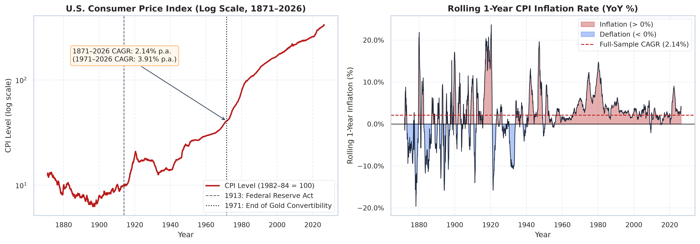
- [`02_annual_inflation_per_year.png`](./figures/02_annual_inflation_per_year.png)
  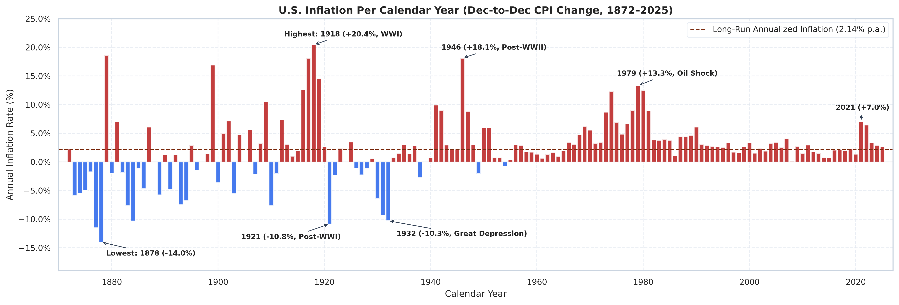

### Univariate Distributions, Wealth & Drawdowns

- [`03_univariate_distributions_kde_box_violin_qq.png`](./figures/03_univariate_distributions_kde_box_violin_qq.png)
  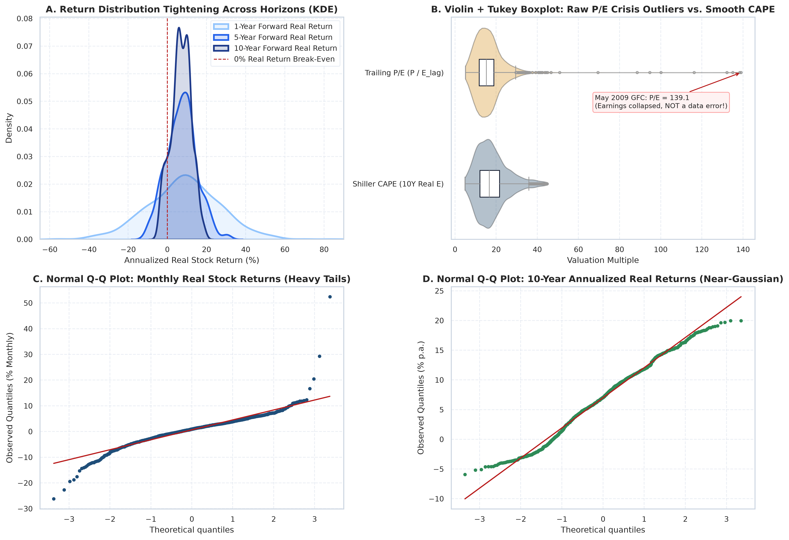
- [`04_real_wealth_and_drawdowns.png`](./figures/04_real_wealth_and_drawdowns.png)
  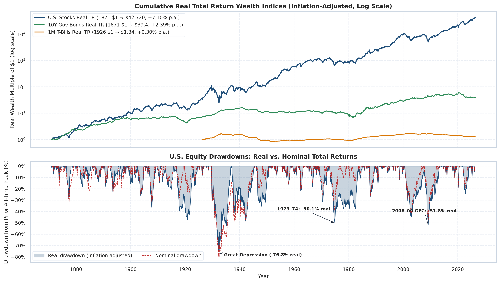

### Holding-Period Win Probabilities, Term Premium & Equity Risk Premium

- [`05_win_probabilities_by_horizon.png`](./figures/05_win_probabilities_by_horizon.png)
  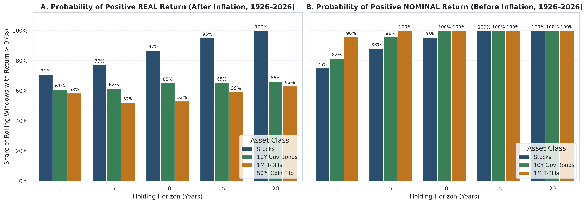
- [`06_return_ranges_by_horizon.png`](./figures/06_return_ranges_by_horizon.png)
  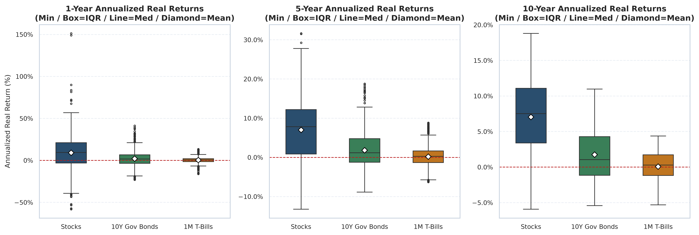
- [`07_term_premium_10y_and_1926_1981_regime.png`](./figures/07_term_premium_10y_and_1926_1981_regime.png)
  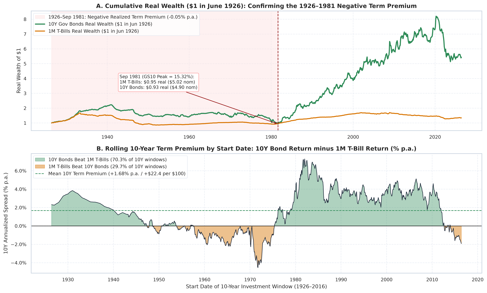
- [`08_equity_risk_premium_10y_vs_tbills.png`](./figures/08_equity_risk_premium_10y_vs_tbills.png)
  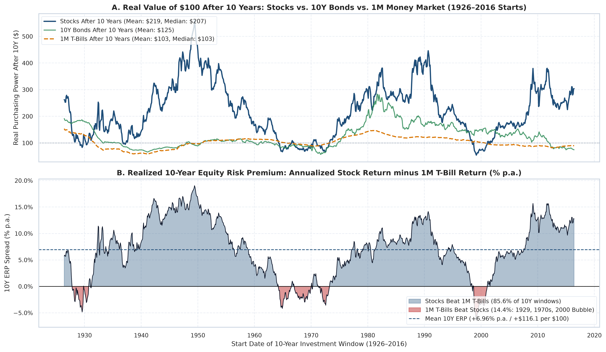

### Multivariate Correlations & Valuation Predictability (`P/E` vs. `CAPE`)

- [`09_inflation_and_stock_bond_correlations.png`](./figures/09_inflation_and_stock_bond_correlations.png)
  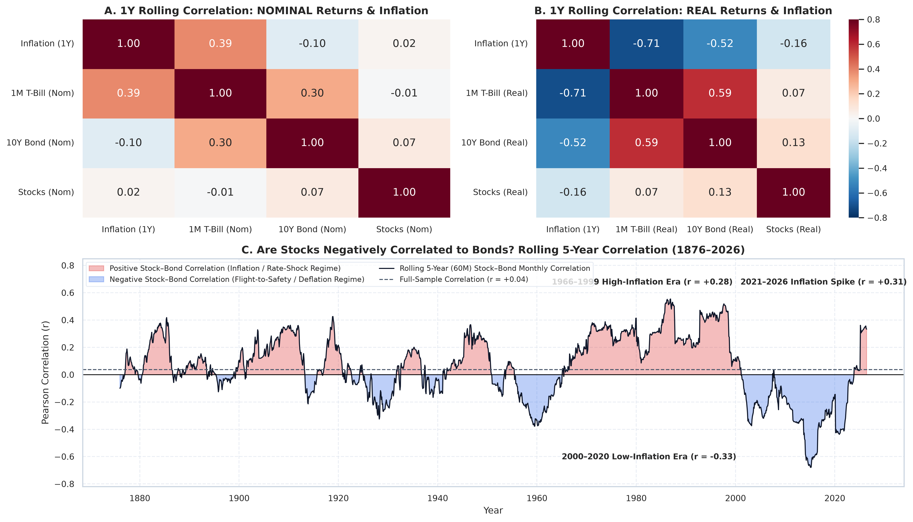
- [`10_pe_and_cape_vs_10y_returns_scatter.png`](./figures/10_pe_and_cape_vs_10y_returns_scatter.png)
  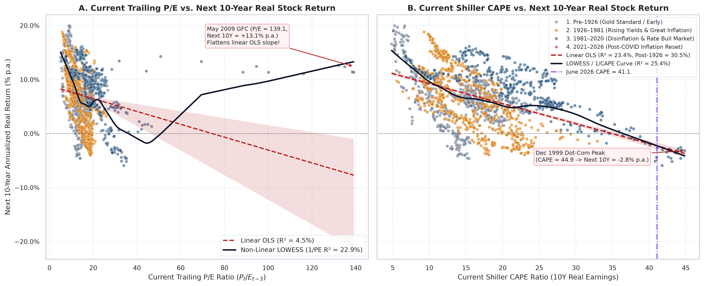
- [`11_pe_vs_cape_horizon_relevance_r2.png`](./figures/11_pe_vs_cape_horizon_relevance_r2.png)
  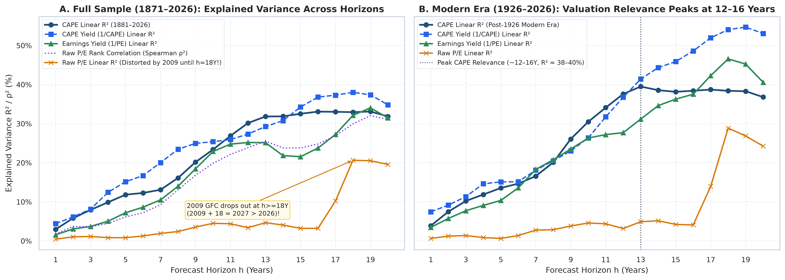
- [`12_multivariate_feature_heatmap_and_regimes.png`](./figures/12_multivariate_feature_heatmap_and_regimes.png)
  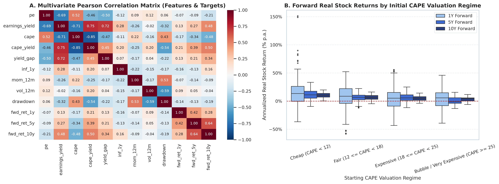
- [`13_multivariate_pairplot.png`](./figures/13_multivariate_pairplot.png)
  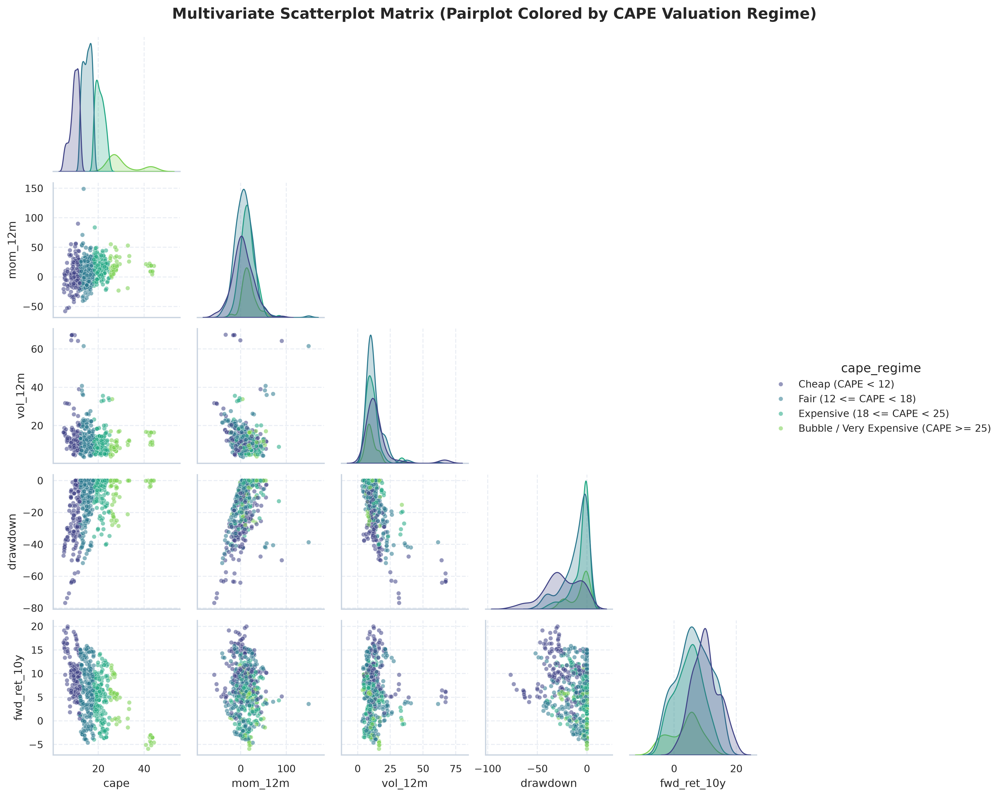

### Lump Sum vs. 12-Month DCA

- [`14_lump_sum_vs_dca_12m_5y.png`](./figures/14_lump_sum_vs_dca_12m_5y.png)
  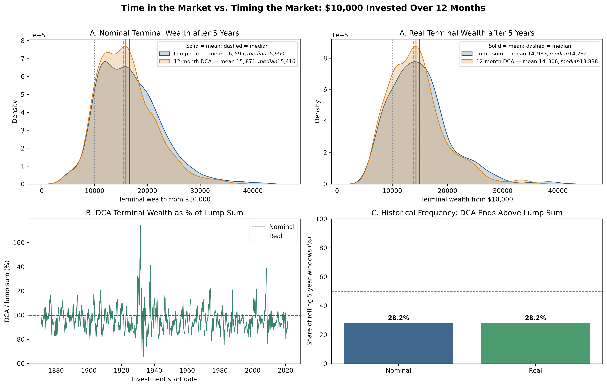

### Rolling Volatility Over Time (Stocks vs. 10-Year Government Bonds)

- [`15_rolling_volatility_stocks_vs_bonds.png`](./figures/15_rolling_volatility_stocks_vs_bonds.png)
  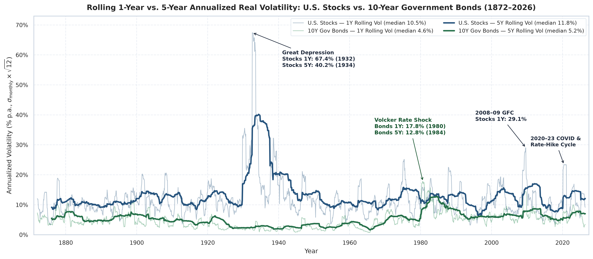
